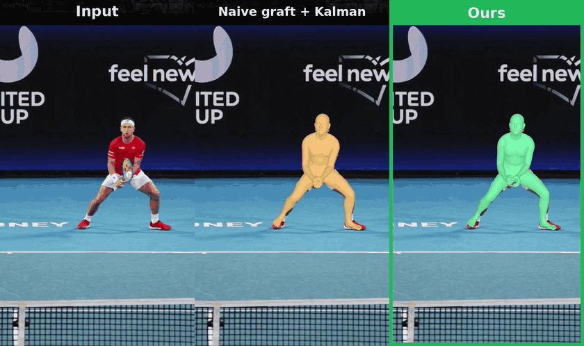
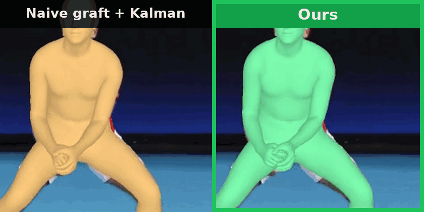

# Motio

**영상 한 편에서 손가락까지 포함한 3D 전신 모션을 추출해, 바로 쓸 수 있는 애니메이션 에셋(SMPL-X / FBX)으로 만들어주는 서비스**

> Monocular video → physically-plausible full-body + hand 3D motion. Fuses GVHMR (body) and HaMeR (hands) with a training-free, twist-aware wrist refinement.

세종대학교 소프트웨어학과 종합설계(캡스톤) 2026 · 4인 팀 · **팀장**



---

## 문제

손까지 포함한 3D 모션을 얻으려면 **전신 모델(GVHMR)** 과 **손 모델(HaMeR)** 의 결과를 하나의 SMPL-X로 합쳐야 합니다. 그런데 HaMeR는 손 크롭만 보고 손목 방향을 추정하기 때문에, 그 손이 **어느 팔에 붙어 있는지 모릅니다.** 손목 회전을 그대로 옮겨 붙이는 일반적인 방식(naive graft)은 그래서 **부자연스러운 전완 비틀림**과 **손–몸 관통**을 만듭니다.

## 핵심 아이디어 — Temporal-core Guided Non-Temporal Fitting

시간축을 보는 **GVHMR(temporal)** 을 뼈대로 삼고, 프레임 단위인 **HaMeR(non-temporal)** 의 손을 그 위에 맞춰 넣습니다. 이때 기준은 **관측 가능한 축과 아닌 축의 분리**입니다.

단안 2D 영상은 **전완 축을 따라 도는 회전(twist)** 을 거의 관측하지 못합니다. 그래서 손목 회전을 둘로 나눠, 각각 믿을 수 있는 쪽에서 가져옵니다.

| 성분 | 2D에서 관측 | 가져오는 곳 |
|---|:--:|---|
| **swing** (굴곡·편위) | 가능 | HaMeR (손 방향) |
| **twist** (전완 비틀림) | 불가능 | 몸(팔 IK)의 물리적 전완 값 |

이 원리를 확장해 후처리를 **서로 간섭하지 않는 단계**로 구성했습니다 (추가 학습 없음).

```
A. 팔 IK        ViTPose 2D로 위치, GVHMR로 깊이 앵커
B. 손목 병합     swing = HaMeR, twist = 전완  (+ 신뢰도 게이트, 불량 프레임 SLERP 보간)
C. ROM clamp    손목 생체역학 범위 제한
D. 충돌 해소     2D에 안 보이는 twist 축으로만 손을 돌려 관통 제거 (2D 정합 손실 0)
E. 그립 보정     손가락만, 가려짐·두 손 겹침 시 IoU/신뢰도 게이트
```

## 결과



<sub>손 부분 확대 (0.33배속). Naive graft는 손목이 뒤로 꺾이거나 비틀리는 반면, Ours는 라켓을 쥔 손목이 팔과 자연스럽게 이어집니다.</sub>

같은 HaMeR 손을 쓰고 **합치는 방식만 바꿔** 비교했습니다 (3D GT가 없는 in-the-wild 영상이라 GT-free 지표 사용).

| 지표 | Naive graft | **Ours** |
|---|:--:|:--:|
| 전완 비틀림 위반율 ↓ (8개 영상 평균) | 7.07% | **5.16%** |
| 손–몸/손–손 관통 프레임 ↓ (front_3) | 243 | **109 (−55%)** |
| 손 2D 정확도 (독립 검출기 MediaPipe PCK) | 0.620 | **0.623** (동등) |

- **2D 정확도는 그대로 두고** 비틀림과 관통만 줄였습니다.
- 2D 평가는 일부러 **어떤 방법도 학습·피팅에 쓰지 않은 MediaPipe**로 채점했습니다. 피팅 대상(WholeBody 키포인트)으로 채점하면 2D에 직접 맞춘 방법이 유리하게 나오는 순환 문제를 확인했기 때문입니다 (0.90 → 독립 기준 0.46).
- 정제 단계 속도: 약 0.04–0.07 s/frame.

자세한 수식·평가: [`poster/METHOD.md`](poster/METHOD.md) · [`poster/V4_EVIDENCE.md`](poster/V4_EVIDENCE.md) · [`docs/V4_JOURNEY.md`](docs/V4_JOURNEY.md)

## 내 역할 (팀장)

- **통합**: 팀원별 모듈(GVHMR 몸 / HaMeR 손)을 하나의 파이프라인으로 병합하고, 프론트엔드–추론 서버를 잇는 백엔드(`motio_backend/`) 구성
- **서버 배포**: FastAPI 비동기 작업 서버, Docker 이미지, RunPod GPU 환경 구축
- **손/손목 후처리**: 위 v4 정제 파이프라인 설계·구현·평가 (`run_v4.sh`, `batch_*.py`, `eval/cap_metrics.py`)

## 기술 스택

PyTorch · PyTorch3D · SMPL-X / MANO · GVHMR · HaMeR · ViTPose · MediaPipe · FastAPI · Docker · RunPod · Blender(FBX)

## 프로젝트 구조

```
├── service.py, entry_point*.py   # 추론 서비스 / CLI 진입점
├── run_v4.sh                     # v4 정제 체인 실행 (A→E)
├── cap_arm_prefit.py, batch_*.py # v4 체인 각 단계 (팔 IK, 손목 병합, ROM, 충돌, 그립)
├── physical_limits.py            # 손목 ROM·swing-twist 분해
├── motio_backend/                # 프론트–추론 서버 연결 FastAPI 백엔드
├── postprocess_pipeline/         # 후처리 → Unreal FBX 변환
├── eval/                         # 평가 지표 (MediaPipe 독립 2D, twist, 충돌) · 비교 baseline
├── render/                       # 비교 영상 렌더링
├── experiments/v4_variants/      # v4 확정 전 실험 변형들
├── wrist_pipeline/               # 이전 버전(v3) 손목 파이프라인
├── deprecated/                   # 폐기한 시도
├── poster/, docs/                # 방법·평가 문서, 포스터 그림
└── hmr4d/, external/hamer/       # GVHMR / HaMeR 런타임
```

---

## 배포 구성

이 저장소는 개발/학습용 파일을 제외하고, 서비스 추론에 필요한 코드와 체크포인트 배치 구조만 분리한 배포용 프로젝트입니다.

## ⭐ Adaptive v4 — 손목/손 정제 (2026-06)

GVHMR(몸) + HaMeR(손) + ViTPose(2D)를 **물리적으로 타당하게 융합**하는 후처리 파이프라인. 단안 영상에서 손목 위치/각도(전완 비틀림)·손가락 그립을 영상에 정합시킵니다. **서비스 기본 모드 = `quality`(=v4).** (레거시 fit2d 경로는 `CAP_OPT_MODE=fast`)

```
[1] 전처리   entry_point_hamer.py : GVHMR + ViTPose + HaMeR → smplx_merged_hamer_post.pt
[2] v4 체인  entry_point_opt.py(_refine_quality):
    A cap_arm_prefit  팔 IK + depth앵커 + ViTPose conf 게이팅
    A2 batch_arm_smooth  가려짐 떨림 제거(conf 게이트)
    B batch_hamer_wrist  손목=HaMeR 각도 + 신뢰도 게이트
    C batch_rom_clamp    전완축 생체역학 손목 한계
    D collision_detect + batch_axcol_v4  충돌을 2D-불변 축회전으로 해소
    E batch_grip_prior   손가락 IoU/conf 게이트(body_pose 불변)
    → hamer_wrist_hamer_rom_col_grip.pt (최종)
```

- 단일 클립 재현: `bash run_v4.sh outputs/cap_pipeline/<clip>`
- **알고리즘·수식**: [docs/V4_ALGORITHM.md](docs/V4_ALGORITHM.md) · **서비스 흐름**: [docs/SERVICE_FLOW.md](docs/SERVICE_FLOW.md) · **발전기록**: [docs/V4_JOURNEY.md](docs/V4_JOURNEY.md)
- **평가 근거**(독립 MediaPipe 2D 최고 · twist/충돌 최저 · vs Dyn-HaMR): [poster/EVALUATION.md](poster/EVALUATION.md) · [poster/V4_EVIDENCE.md](poster/V4_EVIDENCE.md), 그림 `poster/fig*.png`

## 포함한 것

- `entry_point.py`: 단일 영상 추론 CLI
- `batch_entry_point.py`: 폴더 단위 배치 실행 CLI
- `service.py`: 업로드 기반 FastAPI 서비스
- `hmr4d/`, `tools/demo/`: GVHMR 추론 런타임 코드
- `inputs/checkpoints/`: 배포 환경에서 체크포인트를 넣을 자리
- `external/hamer/`: HaMeR 패키지를 둘 자리
- `scripts/check_assets.py`: 필수 모델 파일 확인 스크립트

## 체크포인트 배치

아래 파일들은 라이선스 때문에 이 배포 폴더에 자동 복사하지 않았습니다. 배포 서버에서는 같은 경로로 배치하세요.

```text
inputs/checkpoints/
├── body_models/
│   ├── smpl/SMPL_NEUTRAL.pkl
│   └── smplx/SMPLX_NEUTRAL.npz
├── gvhmr/gvhmr_siga24_release.ckpt
├── hmr2/epoch=10-step=25000.ckpt
├── vitpose/vitpose-h-multi-coco.pth
└── yolo/yolov8x.pt
```

DPVO를 쓸 경우에만 `inputs/checkpoints/dpvo/dpvo.pth`도 필요합니다.

HaMeR는 `external/hamer` 아래에 설치합니다. 설치 후 `external/hamer/hamer` 패키지 디렉터리가 있어야 합니다.

## 설치

```bash
cd cap_deploy
conda create -y -n cap-deploy python=3.10
conda activate cap-deploy
pip install -r requirements.txt
pip install -e .
```

HaMeR는 별도로 클론 및 설치한 뒤 `external/hamer`에 두거나, 실행 시 `--hamer-root`로 경로를 넘기세요.

```bash
python scripts/check_assets.py
```

## CLI 실행

```bash
python entry_point.py \
  --video /path/to/input.mp4 \
  --output-root outputs/cap_pipeline \
  --hamer-root external/hamer \
  --auto-person \
  --no-interactive \
  --skip-result-video
```

결과는 `outputs/cap_pipeline/<video_name>/smplx_merged_hamer.pt`에 생성됩니다. 렌더링 영상까지 만들려면 `--skip-result-video`를 빼세요.

## API 서비스 실행

```bash
uvicorn service:app --host 0.0.0.0 --port 8000
```

요청 예시:

```bash
curl -F "video=@/path/to/input.mp4" \
  -F "skip_result_video=true" \
  http://localhost:8000/runs
```

상태 확인:

```bash
curl http://localhost:8000/runs/<job_id>
```

결과 다운로드:

```bash
curl -O http://localhost:8000/runs/<job_id>/artifacts/merged
curl -O http://localhost:8000/runs/<job_id>/artifacts/report
curl -O http://localhost:8000/runs/<job_id>/artifacts/log
```

## 배포 메모

- GPU/CUDA가 필요합니다. 현재 GVHMR 추론 코드는 CUDA가 없으면 실패하도록 되어 있습니다.
- 서비스에서는 사람 선택 프롬프트를 띄우지 않기 위해 기본적으로 `--auto-person --no-interactive`를 사용합니다.
- 인터넷이 막힌 서버에서는 HaMeR 체크포인트 자동 다운로드가 실패할 수 있으므로 `CAP_HAMER_CHECKPOINT` 환경변수나 API form의 `hamer_checkpoint`로 로컬 파일을 지정하세요.

---

## 손목 파이프라인 (adaptive_v3) 재현

> 손/손목 품질 개선 최종본. 상세 설명·근거는 `docs/WRIST_PIPELINE.md` 참고.
> LIVE 코드만 루트에 있고, 폐기 시도는 `deprecated/`로 격리(삭제 아님).

### 1. 환경
- Python 3.10, CUDA 12.1, GPU(L40S 등)
```bash
python3.10 -m venv venv && source venv/bin/activate
pip install -r requirements.txt      # torch 2.3.0+cu121, pytorch3d 휠, numpy==1.23.5(고정 필수)
pip install -e .                     # GVHMR(hmr4d) 임포트용 (setup.py)
```
- numpy는 반드시 1.23.5 고정 (2.x로 올라가면 pandas/바이너리 충돌).

### 2. 체크포인트
- GVHMR: `inputs/checkpoints/` (위 "체크포인트 배치" 절 참고)
- HaMeR + ViTPose: `external/hamer/_DATA/` (hamer_ckpts, vitpose_ckpts)
- SMPL-X/MANO: `inputs/checkpoints/body_models/`, `external/hamer/_DATA/data/mano/`
  (체크포인트는 git에 넣지 않음 — 각 공식 repo에서 받아 위 경로에 배치)

### 3. 입력 전처리 (영상 → GVHMR + HaMeR + 2D)
```bash
python entry_point_hamer.py --video <video.mp4> --output-root outputs/cap_pipeline \
    --auto-person --no-interactive --skip-result-video
# 산출: <clip>/hmr4d_results.pt, preprocess/{vitpose.pt, wholebody_kp2d.npy}, hamer_out_clean/
```

### 4. adaptive_v3 손목 (단일 영상, tennis=clip "input" 기준)
```bash
python cap_arm_prefit.py                       # ViTPose 팔 fit  -> smplx_arm_prefit.pt
python wrist_pipeline/cap_compare_hmp_modes.py             # base 생성     -> cmp_baseline_hamer.pt
python wrist_pipeline/01_fit_faithful.py       # 2D fit      -> cmp_dynhamr_faithful.pt
python wrist_pipeline/02_adaptive_axial.py     # sudden->GVHMR axial -> cmp_adaptive_v2.pt
python wrist_pipeline/03_badframe_slerp_smooth.py  # bad_frames slerp -> cmp_adaptive_v3.pt
python wrist_pipeline/render_region.py cmp_adaptive_v3.pt render_adaptive_v3_FULL.mp4 0 9999
```
- 위 단일영상 스크립트는 `outputs/cap_pipeline/input/`(tennis 클립) 기준 경로로 설정돼 있습니다. 다른 클립은 5절의 일반화 배치(`batch_*.py`, 경로 동적)를 사용하세요.
- `wrist_pipeline/cap_compare_hmp_modes.py`가 base(cmp_baseline_hamer.pt)를 만든다 — **없으면 adaptive_v3 재현 불가**.

### 5. 여러 영상 일반화 배치 (경로 동적, K 자동)
```bash
CLIP=outputs/cap_pipeline/<stem>
python batch_fit2d.py "$CLIP"            # 강한2D + 회전평활 + 손가락 고정 -> fit2d.pt
python batch_finger_kalman.py "$CLIP"    # 손가락만 Kalman(손목 axial 제외) -> fit2d_fingerkalman.pt
python render/batch_render.py "$CLIP" fit2d.pt render_fit2d.mp4 <video.mp4>
```

### 참고
- 전체 근거/실패기록: `docs/WRIST_PIPELINE.md`, `docs/PIPELINE_MAP.md`
- Dyn-HaMR 비교(별도 격리 환경): `/workspace/Dyn-HaMR` 보존.
